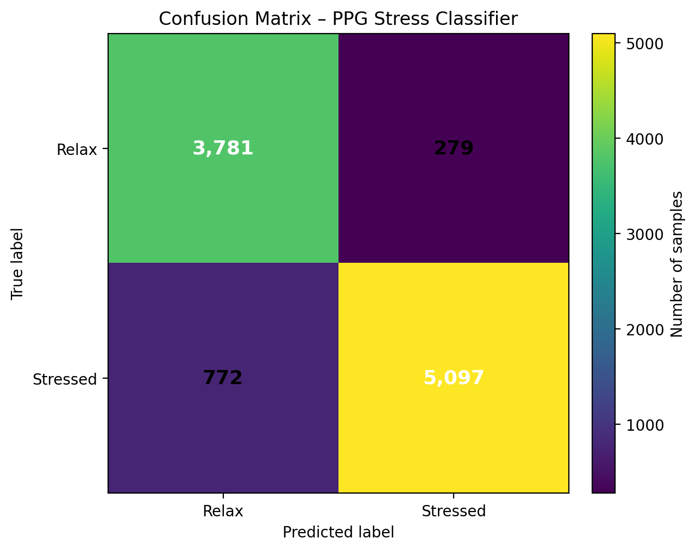

# PPG Stress Classifier: Method and Results

## What the model does

This model classifies each retained data row as **Relax** or **Stressed**. It is a row-level classification model: one numeric CSV row becomes one example, and the row receives the label of its source folder or combined file.

The model uses column B, `ppg_raw`, as its single input feature. Column A, `t_ms`, is used only to identify numeric data rows; it is not a model feature. `ppg_raw` is the optical sensor reading, not beats per minute. The model predicts a stress-related label; it does not estimate BPM or diagnose stress medically.

## Method and training

1. **Read the data.** The trainer reads the labeled training data and the separate testing data. It supports the combined test files `testing/relax_combined.csv` and `testing/stressed_combined.csv`; the combined file takes precedence over a same-label subfolder to avoid duplicate rows.
2. **Clean the signal rows.** Rows with `ppg_raw` below 10,000 are excluded as likely finger-off readings. The combined files were also cleaned by excluding sharp drops below 70% of the average of nearby readings (about a one-second neighborhood). These are practical rules for this sensor and dataset, not universal physiological thresholds.
3. **Train.** A scikit-learn `RandomForestClassifier` is fitted to the training rows. It uses 250 trees, `min_samples_leaf=2`, balanced class weights, and random seed 42. Each row has just one feature: its `ppg_raw` value.
4. **Evaluate.** The fitted model predicts labels for the held-out testing rows. The confusion matrix below counts test rows, with actual labels on rows and predicted labels in columns.

To train from `C:\Users\PC\ep2-starter\logs`:

```powershell
py -m pip install numpy scikit-learn joblib
py .\train_heart_rate.py --data-dir .\cleaned_data
```

The model is saved as `ppg_stress_model.joblib` in the current directory unless `--model-out` is supplied.

## Test result

The supplied confusion matrix contains **9,929 test rows**. Correct classifications are on the diagonal: 3,781 Relax rows and 5,097 Stressed rows.

| Actual label | Predicted Relax | Predicted Stressed |
| --- | ---: | ---: |
| Relax | 3,781 | 279 |
| Stressed | 772 | 5,097 |



From these counts:

- **Accuracy:** 89.4% (8,878 of 9,929 rows classified correctly)
- **Relax recall:** 93.1% (3,781 of 4,060 actual Relax rows)
- **Stressed precision:** 94.8% (5,097 of 5,376 rows predicted Stressed)
- **Stressed recall:** 86.9% (5,097 of 5,869 actual Stressed rows)

So the model correctly flagged most Stressed rows, but it labeled 772 Stressed rows as Relax. It also labeled 279 Relax rows as Stressed.

## How to interpret these results

These are **row-level** metrics, not counts of independent people or recordings. Neighboring PPG rows are highly correlated, and the model uses only one raw sensor value. A high row count therefore does not guarantee that it will work well for new people, sessions, or sensor placements. Raw PPG varies with contact pressure, movement, and individual baseline. Treat this result as an initial experiment; validate on recordings from people and sessions that were not used in training, and consider adding GSR and reliable beat-to-beat features.
