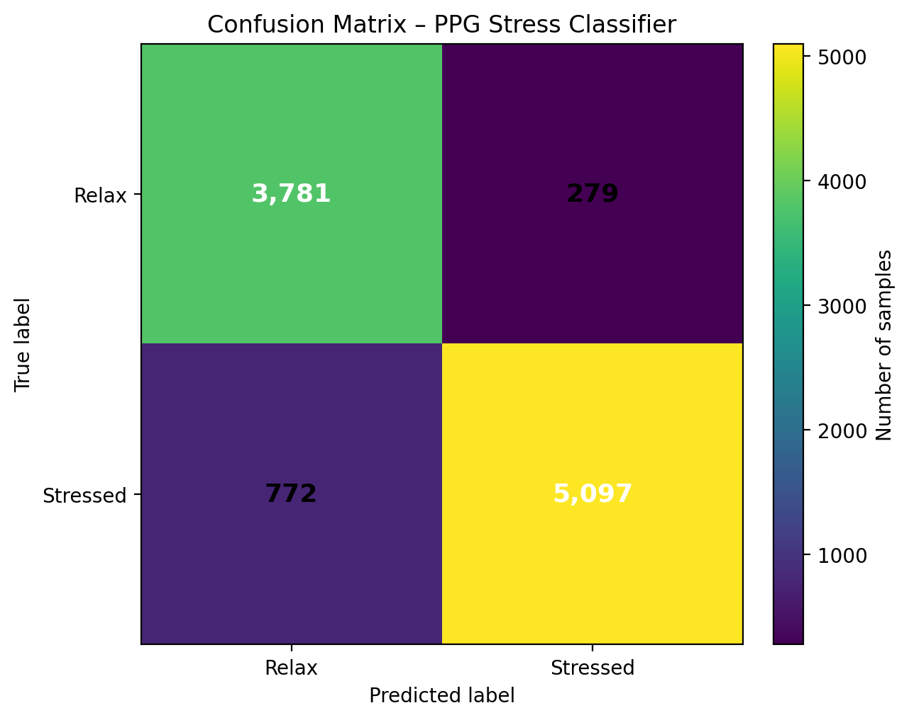

# Project report — PPG stress classification

**Team:** Thao Nguyen, Seonmi Wu

## What it does

The project explores whether raw PPG readings can distinguish recordings labeled Relax from those labeled Stressed. The ESP32-S3 reports a smoothed label from the PPG signal. This is an educational experiment, not a medical diagnosis or a lie detector.

## How it works

The board reads OB1203 PPG and GSR Click sensors at a nominal 50 Hz and streams CSV. The Python script treats each valid row as one sample and trains a 250-tree Random Forest on column B (ppg_raw); column A is timing only. The compact header is included by the detection sketch, which votes over 25 row predictions before printing stress_state. GSR is recorded but is not a model feature.

## Data

Thao Nguyen and Seonmi Wu collected the recordings together. Final labels are Relax and Stressed; the original data-plan template proposed truthful/deceptive labels, but this model does not classify truthfulness. Training contains 17,834 Relax and 12,286 Stressed rows; testing contains 4,060 Relax and 5,869 Stressed rows. Each numeric row is one sample. All cleaned combined CSVs are included under dataset/cleaned_data/ (about 1.1 MB). Cleaning removed PPG below 10,000 and sharp drops below 70% of a roughly one-second local average.

## Results — honestly

The supplied confusion matrix covers 9,929 held-out test rows. It shows 3,781 Relax and 5,097 Stressed rows classified correctly; 279 Relax rows were labeled Stressed and 772 Stressed rows were labeled Relax.

| Actual label | Predicted Relax | Predicted Stressed |
| --- | ---: | ---: |
| Relax | 3,781 | 279 |
| Stressed | 772 | 5,097 |

Accuracy is 89.4%; Relax recall is 93.1%; Stressed precision is 94.8%; and Stressed recall is 86.9%. These are row-level metrics: neighboring readings are correlated. The on-device 25-row vote was not evaluated in this matrix, and these results do not establish performance on new people.

## The two sentences

- **Platform:** ESP32-S3 DevKitC-1 with Arduino and PlatformIO, chosen to read the OB1203 PPG and GSR sensors and run the compact classifier on the board.
- **Threat model:** Asset physiological readings and class labels · threat disclosure of linkable recordings or treating a noisy label as definitive · response minimize identifiers, validate readings, and limit use to an educational demo.

## What was hard, and what we'd do next

PPG values change with finger contact, movement, and personal baseline. The model uses only one raw sensor value, so more participants and testing on people excluded from training are needed. Next we would add GSR and reliable beat-to-beat features, then evaluate the smoothed device output separately.

## Who did what

- **Thao Nguyen:** Led the implementation, data cleaning, model training, evaluation, and report; collected recordings with Seonmi.
- **Seonmi Wu:** Helped Thao collect the sensor recordings.

## AI use

ChatGPT assisted with training and cleaning code, CSV debugging, confusion-matrix interpretation, and report editing. Thao reviewed the outputs; the team is responsible for the data, labels, and conclusions.
